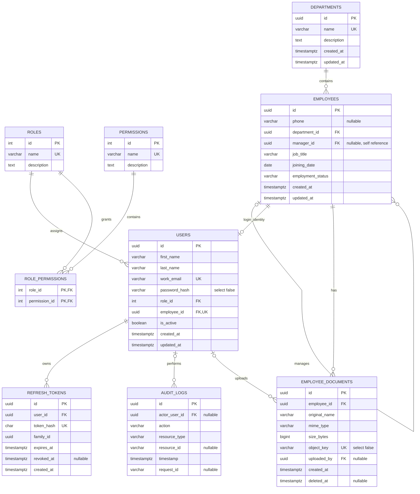

# Entity Relationship Diagram

This diagram reflects the current PostgreSQL migrations. Names and work email are in `users`, not `employees`. Document bytes are stored on local disk; only metadata is in `employee_documents`.

## Constraints And Notes

- UUIDs are used for department, employee, user, token, audit, and document IDs; role and permission IDs are serial integers.
- User work email is unique case-insensitively. `employee_id` is unique in users, enforcing at most one account per employee.
- Employee department and user role/employee references are foreign keys. Manager is a nullable self-reference with `ON DELETE SET NULL`.
- Employment status is constrained to `active`, `inactive`, or `on_leave`; an employee cannot manage themself.
- Refresh token hash is unique; raw refresh tokens are not persisted.
- Audit actor and document uploader references become null when the user is deleted; audit logs have no retention/deletion job in this codebase.
